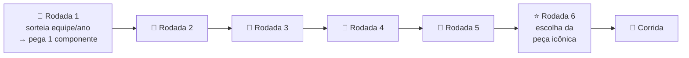

<div align="center">

# 🏎️ F1 Fantasy

**Monte um carro frankenstein com peças de 76 anos de Fórmula 1 e corra contra 21 rivais.**

[](https://www.typescriptlang.org/)
[](https://react.dev/)
[](https://vite.dev/)
[](https://vitest.dev/)
[](#-como-rodar)
[](#-destaques-t%C3%A9cnicos)
[](LICENSE)

> ⚠️ **Projeto de fã, não oficial.** Sem qualquer afiliação, patrocínio ou endosso da Formula 1,
> da FIA ou de qualquer equipe. **Os nomes de pilotos e equipes do jogo são FICTÍCIOS** — inventados
> para este projeto, apoiados sobre fatos históricos reais. Ver
> **[Nomes fictícios](#-nomes-fict%C3%ADcios-o-dataset-do-jogo-n%C3%A3o-usa-nome-real)**.

</div>

---

## 🎮 O que é

F1 Fantasy é um jogo de navegador de **draft e simulação de Fórmula 1**, inspirado nos jogos virais
brasileiros **"7x1"** e **"38 a 0"** — aquela mesma fórmula de sortear, montar e ver no que dá,
com uma partida inteira cabendo num intervalo de almoço.

A ideia é simples e cruel: você não escolhe um carro pronto. Você monta um **frankenstein**.
Sorteia uma equipe e um ano — digamos, Sarterra 2004 — e leva **um único componente** dela. Depois
sorteia de novo, e de novo. No fim você tem um piloto de uma era, um chassi de outra, um motor de
uma terceira, e uma equipe de pit stop que talvez nem existisse quando esse piloto correu. São
**76 temporadas (1950–2025)** e **771 combinações de equipe/ano** no baralho.

As equipes e os pilotos têm **nomes fictícios** — "Sarterra 2004" é uma equipe inventada —, mas as
**notas** de cada um saem de resultados históricos reais daquela temporada. Ver
**[Nomes fictícios](#-nomes-fict%C3%ADcios-o-dataset-do-jogo-n%C3%A3o-usa-nome-real)**.

Aí o carro vai pra pista contra **21 rivais** que passaram exatamente pelo mesmo processo. Quali,
largada, ritmo, estratégia de parada, incidentes — tudo simulado volta a volta, e tudo derivado de
uma **seed**. A mesma seed devolve a mesma corrida, bit a bit, sempre.

---

## 🎲 Como funciona

### O draft: 6 rodadas



Nas **rodadas 1 a 5**, cada jogador recebe um sorteio de equipe/ano e escolhe **um** dos cinco
slots pra preencher com aquela combinação. O que não for pego, se perde:

| Slot                | O que representa                              |
| ------------------- | --------------------------------------------- |
| 🧑‍✈️ **Piloto**       | A dupla de pilotos daquela equipe naquele ano |
| 🏗️ **Chassi**       | O carro, aerodinâmica e comportamento         |
| ⚙️ **Motor**        | A unidade de potência                         |
| 🧠 **Estrategista** | O muro dos boxes — chamadas de parada         |
| 🔧 **Pit**          | A velocidade e a confiabilidade da troca      |

Como só há 5 rodadas para 5 slots, cada sorteio é uma decisão real: aceitar um motor mediano agora
ou torcer por algo melhor e ficar sem opção depois.

Na **rodada 6** vem a **peça icônica** — uma carta de um catálogo de **24 peças** que modifica o
carro montado. É o único momento de escolha aberta do draft.

> 📸 **As três capturas de tela em PNG SAÍRAM deste README em 2026-09-02, e o motivo fica escrito:**
> `draft.png`, `corrida.png` e `campeonato.png` são anteriores à troca por nomes fictícios (a troca
> do dataset é de 2026-08-30; os prints, de 2026-08-08) e por isso **exibiam os nomes reais do
> dataset antigo** — na vitrine do projeto, fora de todo portão. **README sem screenshot é melhor
> que README com screenshot de nome real.** Os arquivos **continuam em `docs/img/`**, não foram
> apagados; **regerá-los com o dataset atual é pendência aberta.** _(A grade de silhuetas em SVG,
> mais abaixo, é gerada por `npm run preview` a partir da geometria de produção, nunca teve nome
> real e **está atual** — por isso ficou.)_

### Os modos

| Modo          | Como é                                                                  |
| ------------- | ----------------------------------------------------------------------- |
| 👤 **Single** | Você + 21 bots                                                          |
| 👥 **Local**  | 2 a 4 jogadores humanos no mesmo dispositivo + bots completando o grid  |
| 🌐 **Online** | Sala por código de 6 dígitos, até 22 jogadores, bots completando o grid |

No **Online**, o anfitrião cria a sala, compartilha o link e o draft acontece ao vivo nas duas
pontas. A corrida roda **no cliente de cada jogador** e o servidor só coordena — é o determinismo
por seed que torna isso possível. Dar F5 no meio do draft devolve você ao mesmo lugar; fechar a aba
e voltar em **até 2 minutos** também. Quem ficar parado perde a vez por inatividade e o jogo segue
sem travar. Ver **[Como rodar](#-como-rodar)** e
**[docs/jogar-em-rede.md](docs/jogar-em-rede.md)** para jogar do celular ou pela rede local.

| Formato                      | Etapas                           |
| ---------------------------- | -------------------------------- |
| 🏁 **Corrida única**         | 1 corrida, resultado na hora     |
| 🏆 **Campeonato curto**      | 5 pistas, com tabela acumulada   |
| 🏆🏆 **Campeonato completo** | 10 pistas — o calendário inteiro |

No campeonato, o calendário é sorteado, cada etapa mostra a miniatura do traçado e a tabela
acumula entre as corridas — com a variação de posição de cada jogador etapa a etapa.

**Os três formatos valem também no Online, e o multiplayer está ENCERRADO** — a fase de rede foi
fechada em 2026-08-27, com corrida e campeonato online entregues. No
campeonato multiplayer o servidor sorteia uma seed independente por etapa e publica **uma de cada
vez**, conforme a etapa abre — nunca a seed-mestre. Não é zelo: com a seed base na mão, qualquer
jogador simularia as corridas futuras no console antes de draftar. Cada etapa só avança quando todos
os elegíveis atestam o fim da anterior.

### Visibilidade: Craque ou Cego

| Modo          | O que você vê                                                                      |
| ------------- | ---------------------------------------------------------------------------------- |
| 👁️ **Craque** | As notas dos componentes e das peças ficam visíveis. Draft de leitura e cálculo.   |
| 🎲 **Cego**   | As notas dos componentes e das peças ficam escondidas — sobram o nome e o **ano**. |

O Modo Cego esconde as notas; não esconde a pista nem o resultado da corrida. É a diferença entre
otimizar uma planilha e apostar no faro — e, com o dataset fictício, o que resta pra apostar é
sobretudo o **ano**: um carro de 1988 não é um de 1950.

---

## 🔬 Destaques técnicos

Esta é a parte de que o projeto se orgulha.

### 🎯 Simulação 100% determinística

**Nenhum `Math.random()` em lugar nenhum da engine** — é regra arquitetural, não boa intenção. Toda
aleatoriedade sai de um RNG semeado explicitamente. Mesma seed + mesmos loadouts ⇒ **mesma corrida,
bit a bit**, em qualquer máquina.

Isso não é purismo: é o que torna o multiplayer online viável com um servidor magro (a corrida roda
no cliente, o servidor só coordena a seed), é o que permite reproduzir um bug a partir de um número,
e é o que sustenta a ideia de um "Desafio do Dia" com a mesma corrida pra todo mundo.

### 📊 Notas derivadas de fatos, não digitadas à mão

As **771 combinações de equipe/ano (1950–2025)** não foram estimadas por opinião. As **notas** são
**derivadas de resultados históricos reais** puxados da API **Jolpica-F1** (sucessora da Ergast) e
processadas por um pipeline versionado:

```
dataset:fetch  →  dataset:fatos  →  dataset:notas  →  dataset:report
  (API pública)   (agrega fatos)   (deriva notas)    (relatório)
```

A normalização é o detalhe que faz a coisa funcionar: cada nota vem do **percentil de Hazen dentro
da própria temporada**, mapeado pra uma faixa-alvo. Ou seja — um carro é medido contra os
adversários que ele realmente enfrentou, não contra a história inteira. Sem isso, a era híbrida
esmagaria os anos 50 por puro avanço tecnológico e o draft perderia a graça.

🔑 **Os NÚMEROS vêm dos fatos; os NOMES são inventados.** O último passo do pipeline troca cada
rótulo por um nome fictício, chaveado por id — as notas não se movem (medido: byte a byte
idênticas dos dois lados). É por isso que o jogo pode ser publicado sem usar marca de terceiros e
mesmo assim continuar sendo um jogo sobre a história da F1.

### ⚖️ Balanceamento medido, não sentido

O projeto tem um **balance harness** próprio (`npm run balance`), rodado fora da suíte normal
porque é pesado. Ele simula em massa e mede:

| Métrica                                                                            | Amostra         |
| ---------------------------------------------------------------------------------- | --------------- |
| **Dominância por década** — nenhuma era pode ser o "botão de vencer"               | 200 campeonatos |
| **Raridade de peça** — com que frequência cada peça icônica aparece                | 200 campeonatos |
| **Taxa de vitória do pole** — a corrida tem que ser decidida no ritmo, não no grid | 400 seeds       |
| **Paradas extras** — incidência de estratégia alternativa                          | 300 seeds       |

Regra do projeto: mudou nota, fórmula ou balanceamento, roda o harness antes de considerar pronto.

### 🧱 Engine e UI separadas de verdade

```
src/engine/   TypeScript puro — draft, notas, quali, corrida, campeonato, RNG.
              NUNCA importa React nem nada de UI. Funções puras: entram dados
              + seed, sai resultado. Sem estado global, sem I/O.
src/ui/       React. Consome a engine, jamais reimplementa regra de jogo.
src/data/     JSON puro: equipe/anos, pistas, peças. Sem lógica.
src/net/      Camada de rede — o redutor PURO da sala (mesma disciplina da
              engine: entra estado + comando, sai estado novo). Isola a rede.
party/        A casca do Durable Object: WebSocket, storage e o relógio. É a
              única parte com I/O — e por isso roda numa suíte à parte.
```

A engine roda em Node sem navegador nenhum. É por isso que o harness consegue simular centenas de
campeonatos num teste.

### 🗺️ 10 pistas com silhueta própria

<div align="center">
  
</div>

Cada traçado é desenhado em SVG a partir de dados de curvatura, com asfalto, limites e zebras
gerados por geometria — **não são imagens de terceiros nem contornos copiados**. Passaram por
**teste cego de reconhecimento: 10/10** (contra linha de base 0/10 antes do redesenho).

A grade acima não é um print: é gerada a partir da **mesma função de geometria que a tela de
corrida usa** (`pathDaVolta`), por `npm run preview` — se o traçado mudar no jogo, muda aqui
também. Regerar é um comando, não um trabalho de captura.

### ✅ 1713 + 42 testes, em duas suítes

**1713 testes em 78 arquivos** (`npm test`) cobrindo engine, UI e o redutor de rede, mais
**42 testes em 7 arquivos** (`npm run test:party`) que rodam a casca do Durable Object dentro do
`workerd` de verdade.

**São duas suítes de propósito, e rodar só uma deixa metade do projeto sem portão:** `party/` roda
num runtime diferente, com config própria, fora do `include` do `npm test`.

Mudança de lógica de simulação neste projeto começa por um **teste que falha** capturando o
comportamento pretendido — só depois vem a implementação.

---

## 🎭 Nomes fictícios: o dataset do jogo não usa nome real

**Por que existe:** com o deploy público decidido, nome real deixou de ser risco contido e virou
bloqueador — e a razão é medida, não jurídica-de-corredor: o dataset **vai inteiro para o bundle
servido**. A contagem de 2026-08-24, sobre o `dist/` de então, era **105/105 nomes de equipe,
1.542/1.542 ids de piloto e 353/353 nomes exibidos**. Não era resíduo em arquivo de teste; era 100%
do dataset, servido a quem abrisse o jogo.

**A trilha de 7 PRs está ENTREGUE (7 de 7, concluída em 2026-08-31).** O que ela trocou:

| PR  | O que                                                                                            | Estado |
| --- | ------------------------------------------------------------------------------------------------ | ------ |
| 1   | **Portão** — conta nome real nos arquivos de dados; falha se a contagem mudar, pra mais ou menos | ✅     |
| 2   | **Funil de literais** — os nomes espalhados em `scripts/` passam a sair de um sítio só           | ✅     |
| 3   | **Peças despidas** — 10 peças icônicas perdem marca e código de modelo, mantêm a inovação        | ✅     |
| 4   | **A tabela** — 458 nomes fictícios (105 equipes + 353 pilotos), chaveados por id                 | ✅     |
| 5   | `anonimizar.ts` + teste diferencial, com `src/data/` ainda intocado                              | ✅     |
| 6   | **A troca** — `src/data/` passa a ser fictício (771 registros reescritos, nomes **e** ids)       | ✅     |
| 7   | Fixture de teste e baseline do portão no piso                                                    | ✅     |

### O que está medido hoje

**O portão** (`scripts/portao-nomes-reais.test.ts`, dentro do `npm test`) mede **6** ocorrências nos
seis JSON de dados — era **9.486** antes da trilha. É asserção de igualdade exata, e **as 6 estão
explicadas desde antes do PR 7**, a pedido do dev (_"o que sobrar precisa estar explicado, não
descoberto depois"_):

    massa    = 2 + 2   sobre-contagem: a peça "Amortecedor de massa" colide com o
                       driverId de Felipe Massa. O dado está limpo; a palavra é comum.
    Red Bull = 1 + 1   "Red Bull Ring", a pista — mantida por decisão (ver abaixo).

**O bundle servido** não tem portão automatizado — a medição é à mão, e foi **refeita nesta
atualização** porque o bundle mudou de hash no PR H4:

    dist/assets/index-UkRE1HGe.js   →  124 ocorrências
       sala = 64 · button = 57 · massa = 2 · Red Bull = 1

Todas as quatro são sobre-contagem ou a pista mantida: `sala` é um `driverId` real e casa com o
vocabulário do modo online; `button` é sobrenome real (Jenson Button) e casa com todo `<button>` do
React. **Contraprova:** `Ferrari`, `McLaren`, `Schumacher`, `Verstappen` e `Senna` dão **0**, e
`Sarterra` — o nome fictício que ocupou o lugar da Ferrari — dá **152**, exatamente a contagem que
`Ferrari` tinha no dataset derivado.

### O que a trilha NÃO resolve, e fica dito

- **As pistas continuam reais, e é decisão de projeto.** 8 das 10 são **topônimos** — Monza, Spa,
  Imola, Suzuka, Interlagos, Silverstone, Mônaco, Nürburgring: são lugares, não marcas. `Montreal`
  perdeu o "(Gilles Villeneuve)"; **`Red Bull Ring` ficou**, porque o id da pista alimenta
  `seedDaEtapa` — trocá-lo seria mudança de comportamento, não renomeação.
- **A peça `Turbo modo-quali BMW anos 80` mantém a marca.** Ficou fora do escopo do PR 3, e o
  portão **não a enxerga**: `BMW` não está no universo de agulhas (não é nome de construtor no
  agregado de fatos), então esse resíduo não aparece nos 6.
- **O histórico do git continua servindo os nomes reais** — decisão consciente do dev, não
  esquecimento: reescrever histórico invalidaria as SHAs citadas na documentação do projeto.
  **"Nomes fictícios entregues" não quer dizer "o repositório está limpo".**
- **O portão mede só os seis JSON de dados.** Não mede `.ts`/`.tsx`, não mede `.md`, não mede o
  bundle e não mede as imagens de `docs/img/`. Quem ler o teste verde e concluir "não há nome real
  no repositório" está errado — ele responde "quanto nome real há nos DADOS", e só isso.

---

## 🔐 Hardening: quatro PRs antes de abrir ao público

Uma auditoria de segurança levantou 17 itens (S1–S17). Quatro PRs (**H1**–**H4**) os endereçaram, e
o placar atual é **12 fechados · 3 parciais · 0 abertos** dos **15 que receberam status** — os
outros dois (S13, S14) **nunca foram avaliados**, e isso fica dito em vez de arredondado para 17.

| PR     | O que entrou                                                                                              |
| ------ | --------------------------------------------------------------------------------------------------------- |
| **H1** | Teto de **5 criações de sala por IP** em janela de 10 s · **CORS com allowlist** no lugar do `*`          |
| **H2** | Teto de **64 conexões por sala** (conta o transporte, não o roster) · **`Origin` validado** no upgrade    |
| **H3** | Teto de **1 `sincronizar` por 2 s** por conexão — o comando que devolve o snapshot inteiro                |
| **H4** | **CSP** sem nenhum `unsafe-*` · **jitter** na escada de reconexão · teto de **20 comandos/s** por conexão |

🔑 **O desenho é o mesmo nos quatro, e é o que os torna testáveis:** a decisão é uma **função pura**
em `src/net/` que recebe relógio, IP e contadores por parâmetro; a casca do Durable Object só lê o
mundo e chama. É por isso que a janela de um rate limit é exercitada no `npm test`, sem relógio
falso e sem `workerd`.

⚠️ **Duas ressalvas que viajam junto com o placar:**

- **A CSP não protege nada hoje**, e o `✅` não deve ser lido de outro jeito: **nada neste
  repositório serve o `dist/`**. O worker serve `/parties/*` e `/criar-sala`; o jogo se joga por
  `npm run dev`, que por desenho não tem CSP. A política é **preparação correta para um deploy que
  ainda não existe**.
- **Socket ocioso é limitado, não expirado.** O teto do H2 impede que conexões caladas cresçam sem
  limite, mas nada as fecha — 64 sockets quietos ainda trancam uma sala. É pendência conhecida.

---

## 📍 Estado atual

**O jogo está pronto para deploy público, e os dois bloqueadores que o seguravam foram fechados:**
o dataset servido não tem mais nome real de piloto nem de equipe, e a superfície de rede passou por
quatro PRs de hardening. Tudo abaixo é medido, na `main`, em 2026-09-02:

| Frente                    | Onde está                                                                                                            |
| ------------------------- | -------------------------------------------------------------------------------------------------------------------- |
| **Fase de rede (online)** | ✅ encerrada em 2026-08-27 — corrida e campeonato online entregues                                                   |
| **Nomes fictícios**       | ✅ 7 de 7 PRs · portão no piso de **6**, todas explicadas · bundle: **124**, todas sobre-contagem ou a pista mantida |
| **Hardening**             | ✅ H1–H4 · **12 fechados · 3 parciais · 0 abertos** dos 15 itens com status (S13/S14 sem status)                     |
| **Testes**                | `npm test` **1713/1713** em 78 arquivos · `npm run test:party` **42/42** em 7                                        |
| **Build**                 | `npm run build` limpo — o chunk medido acima é `index-UkRE1HGe.js`                                                   |

⚠️ **"Pronto para deploy" não é "deploy feito", e três coisas ficam ditas:** (1) **nada neste
repositório serve o `dist/` hoje** — o worker serve só a API da sala, e é por isso que a CSP ainda
não protege ninguém; (2) o **histórico do git** continua com o dataset real, por decisão consciente;
(3) o repositório é **privado**, e abri-lo é decisão à parte.

---

## 🚀 Como rodar

Precisa de **Node LTS**.

```bash
npm install
npm run dev      # http://localhost:5173
```

Isso basta para o **Single**, o **Local** e os dois formatos de campeonato.

### Pro modo Online, dois terminais

```bash
# terminal 1 — o worker/Durable Object da sala
npm run sala     # 127.0.0.1:8787

# terminal 2 — o app
npm run dev      # http://localhost:5173
```

Abra `http://localhost:5173/`, escolha **Online → Criar sala**, copie o link e cole numa segunda
aba (ou mande pra outra pessoa). Quando todos marcarem "Estou pronto", o anfitrião começa o draft.

> ⚠️ **Duas abas do MESMO navegador compartilham o `localStorage`**, e portanto o token da sala —
> a segunda aba reentra como o primeiro jogador. Para testar sozinho, use **outro navegador ou uma
> janela anônima**. Não afeta jogo real, onde cada pessoa está na própria máquina.

Para jogar do celular ou pela rede local, troque o terminal 2 por `npm run dev:rede` e siga o
**[guia de rede](docs/jogar-em-rede.md)** (firewall, túnel, diagnóstico).

### Scripts

| Comando              | O que faz                                                                                                               |
| -------------------- | ----------------------------------------------------------------------------------------------------------------------- |
| `npm run dev`        | Sobe o servidor de desenvolvimento (Vite)                                                                               |
| `npm run dev:rede`   | Idem, exposto na rede local — pra abrir do celular                                                                      |
| `npm run sala`       | Sobe o worker/Durable Object do modo Online (`wrangler`, em `127.0.0.1:8787`)                                           |
| `npm test`           | Suíte principal — 1713 testes (engine, UI, `src/net/`)                                                                  |
| `npm run test:party` | Suíte da casca do Durable Object — 42 testes, roda no `workerd`                                                         |
| `npm run test:watch` | Testes em modo watch                                                                                                    |
| `npm run build`      | `tsc --noEmit` + build de produção                                                                                      |
| `npm run typecheck`  | Só a checagem de tipos                                                                                                  |
| `npm run lint`       | ESLint                                                                                                                  |
| `npm run format`     | Prettier                                                                                                                |
| `npm run balance`    | Balance harness — pesado, roda fora do `npm test`                                                                       |
| `npm run preview`    | Gera os previews visuais em `preview/` (gitignored) **e** a grade de silhuetas em `docs/img/silhuetas.svg` (versionada) |

### Pipeline de dados

Só é necessário pra **regerar** o dataset — o resultado já está versionado em `src/data/`.

| Comando                  | O que faz                             |
| ------------------------ | ------------------------------------- |
| `npm run dataset:fetch`  | Baixa os fatos crus da API Jolpica-F1 |
| `npm run dataset:fatos`  | Agrega os fatos por equipe/ano        |
| `npm run dataset:notas`  | Deriva as notas por percentil         |
| `npm run dataset:report` | Relatório do dataset gerado           |

---

## 🛠️ Stack

| Camada    | Tecnologia                                                               |
| --------- | ------------------------------------------------------------------------ |
| Engine    | **TypeScript** puro, sem dependência de UI                               |
| Front-end | **React 19** + **Vite 7** + SVG                                          |
| Testes    | **Vitest 4** + **@cloudflare/vitest-pool-workers** (a suíte do `party/`) |
| Online    | **partyserver** + **wrangler** — Durable Objects na borda da Cloudflare  |

Cada sala é um **Durable Object isolado**. A corrida roda **no cliente** e o servidor só coordena —
o determinismo por seed é justamente o que permite esse desenho: o servidor não precisa simular
nada, e nem sequer carrega o dataset.

> 📌 **Foi `partykit` no papel, é `partyserver` no código.** A troca é deliberada: o pacote
> `partykit` está sem release desde 2025-09, enquanto o `partyserver` segue publicando no mesmo
> monorepo da Cloudflare. O princípio do primeiro dia não mudou — sala = Durable Object isolado —,
> só o CLI (`partykit dev` → `wrangler dev`).

---

## 📜 Créditos e avisos

### Fonte dos dados

Os fatos históricos que alimentam o pipeline vêm da **[API Jolpica-F1](https://api.jolpi.ca/ergast/f1/)**,
sucessora da [Ergast Developer API](https://ergast.com/mrd/). Agradecimento sincero a quem mantém
esse serviço público — sem ele este projeto não existiria na forma em que está.

O que entra são **fatos históricos públicos** (resultados, posições, participações), e é deles que
as **notas** são derivadas. **O que sai são nomes fictícios:** o dataset servido pelo jogo não
carrega nome de piloto nem de equipe reais. As **pistas** são exceção declarada — são lugares
reais, e estão nomeadas como tal (ver
[Nomes fictícios](#-nomes-fict%C3%ADcios-o-dataset-do-jogo-n%C3%A3o-usa-nome-real)).

### Aviso

> **Este é um projeto de fã, sem fins oficiais.** Não possui qualquer afiliação, patrocínio,
> licenciamento ou endosso da **Formula 1**, da **FIA**, da Formula One World Championship Limited,
> ou de qualquer equipe, piloto ou fabricante. _F1_, _FORMULA 1_, _GRAND PRIX_ e marcas
> relacionadas pertencem a seus respectivos titulares. Nenhuma arte, logotipo ou material gráfico de
> terceiros é incorporado ao projeto — os traçados de pista e os elementos visuais são originais.
> **Os nomes de pilotos e equipes que aparecem no jogo são inventados**; qualquer semelhança com
> pessoa real é involuntária.

### Licença

O **código** deste projeto está sob a **[Licença MIT](LICENSE)** — use, modifique e distribua à
vontade, mantendo o aviso de copyright.

A MIT cobre **o que foi escrito aqui**: a engine, a interface, os scripts, os traçados de pista
originais e a tabela de nomes fictícios. Ela **não** concede nem reivindica direito algum sobre
nomes de circuitos ou marcas de terceiros que ainda apareçam no projeto — esses continuam com seus
respectivos titulares, e nada nesta licença muda isso. Os fatos históricos derivados da API
Jolpica-F1 seguem os termos da própria fonte.
