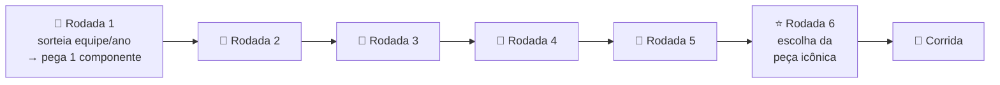
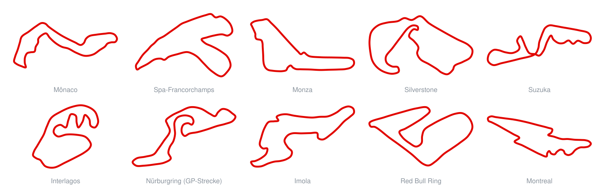
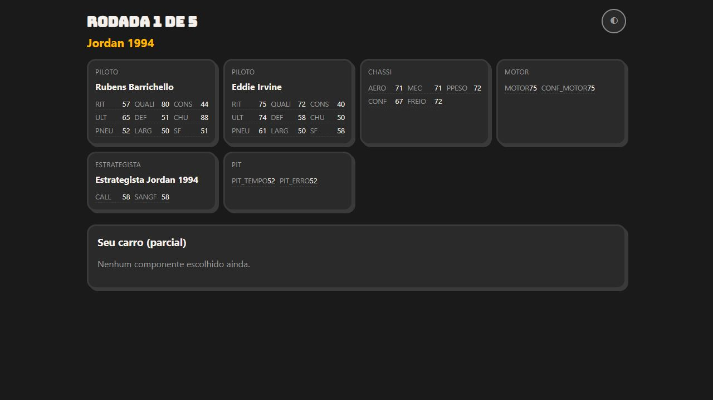

<div align="center">

# 🏎️ F1 Fantasy

**Monte um carro frankenstein com peças de 76 anos de Fórmula 1 e corra contra 21 rivais.**

**[Jogar agora](https://f1-fantasy-sala.marcosfeliperigoto.workers.dev)**

[](https://www.typescriptlang.org/)
[](https://react.dev/)
[](https://vite.dev/)
[](https://vitest.dev/)
[](#-como-rodar)
[](#-destaques-t%C3%A9cnicos)
[](LICENSE)

> ⚠️ **Projeto de fã, não oficial.** Sem qualquer afiliação, patrocínio ou endosso da Formula 1,
> da FIA ou de qualquer equipe. Os nomes de pilotos e equipes são referências históricas aos dados da API Jolpica-F1.

</div>

---

## 🎮 O que é

F1 Fantasy é um jogo de navegador de **draft e simulação de Fórmula 1**, inspirado nos jogos virais
brasileiros **"7x1"** e **"38 a 0"** — aquela mesma fórmula de sortear, montar e ver no que dá,
com uma partida inteira cabendo num intervalo de almoço.

A ideia é simples e cruel: você não escolhe um carro pronto. Você monta um **frankenstein**.
Sorteia uma equipe e um ano — digamos, Ferrari 2004 — e leva **um único componente** dela. Depois
sorteia de novo, e de novo. No fim você tem um piloto de uma era, um chassi de outra, um motor de
uma terceira, e uma equipe de pit stop que talvez nem existisse quando esse piloto correu. São
**76 temporadas (1950–2025)** e **771 combinações de equipe/ano** no baralho.

Os nomes originais de equipes e pilotos acompanham as notas derivadas dos resultados históricos.

Aí o carro vai pra pista contra **21 rivais** que passaram exatamente pelo mesmo processo. Quali,
largada, ritmo, estratégia de parada, incidentes — tudo simulado volta a volta, e tudo derivado de
uma **seed**. A mesma seed devolve a mesma corrida, bit a bit, sempre.

---

## 🎲 Como funciona

### O draft: 6 rodadas



Nas **rodadas 1 a 5**, cada jogador recebe um sorteio de equipe/ano e escolhe **um** dos cinco
slots pra preencher com aquela combinação. O que não for pego, se perde:

| Slot                | O que representa                               |
| ------------------- | ---------------------------------------------- |
| 🧑‍✈️ **Piloto**       | Um dos dois pilotos daquela equipe naquele ano |
| 🏗️ **Chassi**       | O carro, aerodinâmica e comportamento          |
| ⚙️ **Motor**        | A unidade de potência                          |
| 🧠 **Estrategista** | O muro dos boxes — chamadas de parada          |
| 🔧 **Pit**          | A velocidade e a confiabilidade da troca       |

Como só há 5 rodadas para 5 slots, cada sorteio é uma decisão real: aceitar um motor mediano agora
ou torcer por algo melhor e ficar sem opção depois.

Na **rodada 6** vem a **peça icônica** — uma carta de um catálogo de **24 peças** que modifica o
carro montado. É o único momento de escolha aberta do draft.

### Os modos

| Modo          | Como é                                                                  |
| ------------- | ----------------------------------------------------------------------- |
| 👤 **Single** | Você + 21 bots                                                          |
| 👥 **Local**  | 2 a 4 jogadores humanos no mesmo dispositivo + bots completando o grid  |
| 🌐 **Online** | Sala por código de 6 dígitos, até 22 jogadores, bots completando o grid |

No **Online**, o anfitrião cria a sala, compartilha o link e o draft acontece ao vivo nas duas
pontas. A corrida roda **no cliente de cada jogador** e o servidor só coordena — é o determinismo
por seed que torna isso possível. Dar F5 no meio do draft devolve você ao mesmo lugar; fechar a aba
e voltar em **até 2 minutos** também. Quem ficar parado perde a vez por inatividade e o jogo segue
sem travar. Ver **[Como rodar](#-como-rodar)** e
**[docs/jogar-em-rede.md](docs/jogar-em-rede.md)** para jogar do celular ou pela rede local.

| Formato                      | Etapas                           |
| ---------------------------- | -------------------------------- |
| 🏁 **Corrida única**         | 1 corrida, resultado na hora     |
| 🏆 **Campeonato curto**      | 5 pistas, com tabela acumulada   |
| 🏆🏆 **Campeonato completo** | 10 pistas — o calendário inteiro |

No campeonato, o calendário é sorteado, cada etapa mostra a miniatura do traçado e a tabela
acumula entre as corridas — com a variação de posição de cada jogador etapa a etapa.

**O Online usa campeonato curto de cinco etapas.** Corrida única e campeonato de dez etapas
estão disponíveis nos modos Single e Local. No
campeonato multiplayer o servidor sorteia uma seed independente por etapa e publica **uma de cada
vez**, conforme a etapa abre — nunca a seed-mestre. Não é zelo: com a seed base na mão, qualquer
jogador simularia as corridas futuras no console antes de draftar. A etapa avança quando todos
os jogadores elegíveis terminam o replay, ou quando vence o timeout do servidor.

### Visibilidade: Craque ou Cego

| Modo          | O que você vê                                                                      |
| ------------- | ---------------------------------------------------------------------------------- |
| 👁️ **Craque** | As notas dos componentes e das peças ficam visíveis. Draft de leitura e cálculo.   |
| 🎲 **Cego**   | As notas dos componentes e das peças ficam escondidas — sobram o nome e o **ano**. |

O Modo Cego esconde as notas; não esconde a pista nem o resultado da corrida. É a diferença entre
otimizar uma planilha e apostar no faro — o **ano** também faz parte da decisão: um carro de 1988 não é um de 1950.

---

## 🔬 Destaques técnicos

Esta é a parte de que o projeto se orgulha.

### 🎯 Simulação 100% determinística

**Nenhum `Math.random()` em lugar nenhum da engine** — é regra arquitetural, não boa intenção. Toda
aleatoriedade sai de um RNG semeado explicitamente. Mesma seed + mesmos loadouts ⇒ **mesma corrida,
bit a bit**, em qualquer máquina.

Isso não é purismo: é o que torna o multiplayer online viável com um servidor magro (a corrida roda
no cliente, o servidor só coordena a seed), é o que permite reproduzir um bug a partir de um número,
e é o que sustenta a ideia de um "Desafio do Dia" com a mesma corrida pra todo mundo.

### 📊 Notas derivadas de fatos, não digitadas à mão

As **771 combinações de equipe/ano (1950–2025)** não foram estimadas por opinião. As **notas** são
**derivadas de resultados históricos reais** puxados da API **Jolpica-F1** (sucessora da Ergast) e
processadas por um pipeline versionado:

```
dataset:fetch → dataset:fatos → dataset:notas → dataset:publicar → dataset:report
 API pública    agrega fatos    deriva notas    publica no app    relatório
```

A normalização é o detalhe que faz a coisa funcionar: cada nota vem do **percentil de Hazen dentro
da própria temporada**, mapeado pra uma faixa-alvo. Ou seja — um carro é medido contra os
adversários que ele realmente enfrentou, não contra a história inteira. Sem isso, a era híbrida
esmagaria os anos 50 por puro avanço tecnológico e o draft perderia a graça.

A publicação preserva os nomes históricos e todas as notas do derivado.

### ⚖️ Balanceamento medido, não sentido

O projeto tem um **balance harness** próprio (`npm run balance`), rodado fora da suíte normal
porque é pesado. Ele simula em massa e mede:

| Métrica                                                                            | Amostra         |
| ---------------------------------------------------------------------------------- | --------------- |
| **Dominância por década** — nenhuma era pode ser o "botão de vencer"               | 200 campeonatos |
| **Raridade de peça** — com que frequência cada peça icônica aparece                | 200 campeonatos |
| **Taxa de vitória do pole** — a corrida tem que ser decidida no ritmo, não no grid | 400 seeds       |
| **Paradas extras** — incidência de estratégia alternativa                          | 300 seeds       |

Regra do projeto: mudou nota, fórmula ou balanceamento, roda o harness antes de considerar pronto.

### 🧱 Engine e UI separadas de verdade

```
src/engine/   TypeScript puro — draft, notas, quali, corrida, campeonato, RNG.
              NUNCA importa React nem nada de UI. Funções puras: entram dados
              + seed, sai resultado. Sem estado global, sem I/O.
src/ui/       React. Consome a engine, jamais reimplementa regra de jogo.
src/data/     JSON puro: equipe/anos, pistas, peças. Sem lógica.
src/net/      Camada de rede — o redutor PURO da sala (mesma disciplina da
              engine: entra estado + comando, sai estado novo). Isola a rede.
party/        A casca do Durable Object: WebSocket, storage e o relógio. É a
              única parte com I/O — e por isso roda numa suíte à parte.
```

A engine roda em Node sem navegador nenhum. É por isso que o harness consegue simular centenas de
campeonatos num teste.

### 🗺️ 10 pistas com silhueta própria

<div align="center">
  
</div>

Cada traçado é desenhado em SVG a partir de dados de curvatura, com asfalto, limites e zebras
gerados por geometria — **não são imagens de terceiros nem contornos copiados**. Passaram por
**teste cego de reconhecimento: 10/10** (contra linha de base 0/10 antes do redesenho).

A grade acima não é um print: é gerada a partir da **mesma função de geometria que a tela de
corrida usa** (`pathDaVolta`), por `npm run preview` — se o traçado mudar no jogo, muda aqui
também. Regerar é um comando, não um trabalho de captura.

### ✅ 1764 + 46 testes, em duas suítes

**1764 testes em 81 arquivos** (`npm test`) cobrindo engine, UI e o redutor de rede, mais
**46 testes em 8 arquivos** (`npm run test:party`) que rodam a casca do Durable Object dentro do
`workerd` de verdade.

**São duas suítes de propósito, e rodar só uma deixa metade do projeto sem portão:** `party/` roda
num runtime diferente, com config própria, fora do `include` do `npm test`.

Mudança de lógica de simulação neste projeto começa por um **teste que falha** capturando o
comportamento pretendido — só depois vem a implementação.

---

## Nomes históricos



O jogo usa nomes originais de pilotos, equipes, peças e circuitos. O derivado real é
publicado com `npm run dataset:publicar`; a cerca de publicação confere a igualdade
do arquivo servido com o derivado em cada execução de testes.

A fixture mantém suas notas congeladas. A migração reversa restaurou nomes e ids
sem alterar notas, anos ou ordem; assinaturas SHA-256 verificam essa preservação.
A contagem de nomes é uma cerca de estabilidade (não uma proibição): 9237 no dataset,
254 na fixture, 19 em cada catálogo de peças e 2 em cada catálogo de pistas.

A tabela fictícia e as funções puras antigas permanecem como proveniência testada;
as CLIs de anonimização foram aposentadas.

**Versão atual: 3.4.7.** Salas de versões diferentes não podem compartilhar clientes.
Saves anteriores ao formato 4 são incompatíveis: após atualizar, comece uma sala ou
um campeonato novo.

## 🔐 Hardening: quatro PRs antes de abrir ao público

Uma auditoria de segurança levantou 17 itens (S1–S17). Quatro PRs (**H1**–**H4**) os endereçaram, e
o placar atual é **12 fechados · 3 parciais · 0 abertos** dos **15 que receberam status** — os
outros dois (S13, S14) **nunca foram avaliados**, e isso fica dito em vez de arredondado para 17.

| PR     | O que entrou                                                                                              |
| ------ | --------------------------------------------------------------------------------------------------------- |
| **H1** | Teto de **5 criações de sala por IP** em janela de 10 s · **CORS com allowlist** no lugar do `*`          |
| **H2** | Teto de **64 conexões por sala** (conta o transporte, não o roster) · **`Origin` validado** no upgrade    |
| **H3** | Teto de **1 `sincronizar` por 2 s** por conexão — o comando que devolve o snapshot inteiro                |
| **H4** | **CSP** sem nenhum `unsafe-*` · **jitter** na escada de reconexão · teto de **20 comandos/s** por conexão |

🔑 **O desenho é o mesmo nos quatro, e é o que os torna testáveis:** a decisão é uma **função pura**
em `src/net/` que recebe relógio, IP e contadores por parâmetro; a casca do Durable Object só lê o
mundo e chama. É por isso que a janela de um rate limit é exercitada no `npm test`, sem relógio
falso e sem `workerd`.

⚠️ **Duas ressalvas que viajam junto com o placar:**

- **A CSP está ativa no build integrado**, servido por `npm run start:local`.
  O servidor de desenvolvimento Vite continua sem essa política.
- **Socket sem identificação expira após 60 segundos**, verificado pelo alarme periódico.
  Jogadores identificados não são expulsos por essa regra. Hashes têm orçamento separado
  das jogadas, e recusas de conexão por política não entram em reconexão infinita.

---

## 📍 Estado atual

**O jogo está publicado na Cloudflare Workers.**
Abra [F1 Fantasy](https://f1-fantasy-sala.marcosfeliperigoto.workers.dev).
O modo online foi testado com amigos, conforme confirmação do responsável pelo projeto.
Nomes históricos restaurados em 2026-10-17; H1–H4 são da auditoria anterior.

| Frente                    | Onde está                                                                                          |
| ------------------------- | -------------------------------------------------------------------------------------------------- |
| **Fase de rede (online)** | ✅ encerrada em 2026-08-27 — corrida e campeonato online entregues                                 |
| **Hardening**             | ✅ H1–H4 · **12 fechados · 3 parciais · 0 abertos** dos 15 itens com status (S13/S14 sem status)   |
| **Testes**                | `npm test` **1764/1764** em 81 arquivos · `npm run test:party` **46/46** em 8                      |
| **Build**                 | `npm run build` aprovado — build integrado com os nomes originais; aviso de chunk grande permanece |

O Worker serve `dist/` e a API na mesma origem, com `ENVIRONMENT=production` e
`ALLOWED_ORIGINS` limitado ao endereço público acima. O CI valida mudanças; o deploy é manual.

---

## 🚀 Como rodar

Precisa de **Node 24** (também usado no CI). O dataset já vem no repositório;
não é necessário baixar os dados históricos para jogar.

### Testar no computador

No PowerShell, dentro da pasta do projeto:

```powershell
cd "E:\projetos\F1 fantasy"
npm ci
npm run start:local
```

`npm ci` instala as dependências de um clone novo e deve ser repetido quando o
arquivo de dependências mudar. Nas próximas execuções, basta `npm run start:local`.

Espere aparecer `Ready on http://127.0.0.1:8787` e abra
**[http://127.0.0.1:8787](http://127.0.0.1:8787)**. Mantenha o terminal aberto.
O comando compila e serve o frontend e o servidor de salas na mesma origem,
sem login na Cloudflare. O acesso fica restrito ao próprio computador.

Para encerrar, pressione **Ctrl+C**. Se a porta 8787 estiver ocupada, encerre a
execução anterior. Pare o servidor antes de recompilar e iniciar novamente.

### Testar o Online com dois jogadores no mesmo computador

1. Escolha **Online → Criar ou entrar numa sala → Criar sala**.
2. Entre na sala, informe seu nome e copie o link.
3. Abra o link em **outro navegador ou janela anônima** e entre com outro nome.
4. Marque **Estou pronto** nos dois jogadores; no anfitrião 👑, clique em **Começar o draft**.
5. Faça as cinco escolhas de componentes e escolha a peça icônica em cada jogador.
6. Clique em **Largar** nos dois. **Acelerar ⏩** pula o replay daquele jogador.
7. Termine as cinco etapas e confira se os resultados e o pódio são iguais.

Experimente dar **F5 durante o draft ou no grid**: a identidade e a etapa atual
devem ser recuperadas. Duas abas na mesma sessão de navegador compartilham o
`localStorage` e o token da sala, então não representam dois jogadores diferentes.

Veja também o [guia de teste local](docs/deploy-local.md).

### Desenvolver Single e Local

```bash
npm run dev  # http://localhost:5173
```

O Vite atualiza o frontend durante o desenvolvimento. Para Online, inicie também
o Worker conforme abaixo.

### Desenvolver o modo Online, dois terminais

```bash
# terminal 1 — o worker/Durable Object da sala
npm run build    # gera os assets antes de iniciar o Worker
npm run sala     # 127.0.0.1:8787

# terminal 2 — o app
npm run dev      # http://localhost:5173
```

Abra `http://localhost:5173/`, escolha **Online → Criar sala**, copie o link e cole numa segunda
aba (ou mande pra outra pessoa). Quando todos marcarem "Estou pronto", o anfitrião começa o draft.

> ⚠️ **Duas abas do MESMO navegador compartilham o `localStorage`**, e portanto o token da sala —
> a segunda aba reentra como o primeiro jogador. Para testar sozinho, use **outro navegador ou uma
> janela anônima**. Não afeta jogo real, onde cada pessoa está na própria máquina.

Para jogar do celular ou pela rede local, troque o terminal 2 por `npm run dev:rede` e siga o
**[guia de rede](docs/jogar-em-rede.md)** (firewall, túnel, diagnóstico).

### Verificação automática

O workflow `.github/workflows/ci.yml` executa lint, suíte principal, build (com typecheck e
dry-run do Worker) e suíte Worker em Node 24. Não faz deploy.

### Scripts

| Comando               | O que faz                                                                                                               |
| --------------------- | ----------------------------------------------------------------------------------------------------------------------- |
| `npm run dev`         | Sobe o servidor de desenvolvimento (Vite)                                                                               |
| `npm run start:local` | Compila e serve frontend e Worker em `http://127.0.0.1:8787`, com CSP e origens locais explícitas                       |
| `npm run dev:rede`    | Idem, exposto na rede local — pra abrir do celular                                                                      |
| `npm run sala`        | Sobe o worker/Durable Object do modo Online (`wrangler`, em `127.0.0.1:8787`)                                           |
| `npm test`            | Suíte principal — 1764 testes (engine, UI, `src/net/`)                                                                  |
| `npm run test:party`  | Suíte do Worker — 46 testes no `workerd`; execute `npm run build` antes para gerar os assets                            |
| `npm run test:watch`  | Testes em modo watch                                                                                                    |
| `npm run build`       | Typecheck, build do frontend e inspeção do bundle do Worker em dry-run                                                  |
| `npm run typecheck`   | Só a checagem de tipos                                                                                                  |
| `npm run lint`        | ESLint                                                                                                                  |
| `npm run format`      | Prettier                                                                                                                |
| `npm run balance`     | Balance harness — pesado, roda fora do `npm test`                                                                       |
| `npm run preview`     | Gera os previews visuais em `preview/` (gitignored) **e** a grade de silhuetas em `docs/img/silhuetas.svg` (versionada) |

### Pipeline de dados

Só é necessário pra **regerar** o dataset — o resultado já está versionado em `src/data/`.

| Comando                    | O que faz                              |
| -------------------------- | -------------------------------------- |
| `npm run dataset:fetch`    | Baixa os fatos crus da API Jolpica-F1  |
| `npm run dataset:fatos`    | Agrega os fatos por equipe/ano         |
| `npm run dataset:notas`    | Deriva as notas por percentil          |
| `npm run dataset:publicar` | Publica o derivado com nomes originais |
| `npm run dataset:report`   | Relatório do dataset gerado            |

---

## 🛠️ Stack

| Camada    | Tecnologia                                                               |
| --------- | ------------------------------------------------------------------------ |
| Engine    | **TypeScript** puro, sem dependência de UI                               |
| Front-end | **React 19** + **Vite 7** + SVG                                          |
| Testes    | **Vitest 4** + **@cloudflare/vitest-pool-workers** (a suíte do `party/`) |
| Online    | **partyserver** + **wrangler** — Durable Objects na borda da Cloudflare  |

Cada sala é um **Durable Object isolado**. A corrida roda **no cliente** e o servidor só coordena —
o determinismo por seed é justamente o que permite esse desenho: o servidor não precisa simular
nada, e nem sequer carrega o dataset.

O servidor usa `partyserver` e o CLI `wrangler`. Cada sala mantém seu estado em
um Durable Object; o frontend usa WebSocket para enviar escolhas e receber snapshots.

---

## 📜 Créditos e avisos

### Fonte dos dados

Os fatos históricos que alimentam o pipeline vêm da **[API Jolpica-F1](https://api.jolpi.ca/ergast/f1/)**,
sucessora da [Ergast Developer API](https://ergast.com/mrd/). Agradecimento sincero a quem mantém
esse serviço público — sem ele este projeto não existiria na forma em que está.

O pipeline deriva notas de resultados históricos públicos e preserva os nomes originais
de pilotos e equipes. As pistas e peças também usam suas referências históricas.

### Aviso

> **Este é um projeto de fã, sem fins oficiais.** Não possui qualquer afiliação, patrocínio,
> licenciamento ou endosso da **Formula 1**, da **FIA**, da Formula One World Championship Limited,
> ou de qualquer equipe, piloto ou fabricante. _F1_, _FORMULA 1_, _GRAND PRIX_ e marcas
> relacionadas pertencem a seus respectivos titulares. Nenhuma arte, logotipo ou material gráfico de
> terceiros é incorporado ao projeto — os traçados de pista e os elementos visuais são originais.
> Os nomes de pilotos, equipes e circuitos são referências históricas.

### Licença

O **código** deste projeto está sob a **[Licença MIT](LICENSE)** — use, modifique e distribua à
vontade, mantendo o aviso de copyright.

A MIT cobre **o que foi escrito aqui**: a engine, a interface, os scripts, os traçados de pista
originais e os scripts de dados. Ela **não** concede nem reivindica direito algum sobre
nomes de circuitos ou marcas de terceiros que ainda apareçam no projeto — esses continuam com seus
respectivos titulares, e nada nesta licença muda isso. Os fatos históricos derivados da API
Jolpica-F1 seguem os termos da própria fonte.
