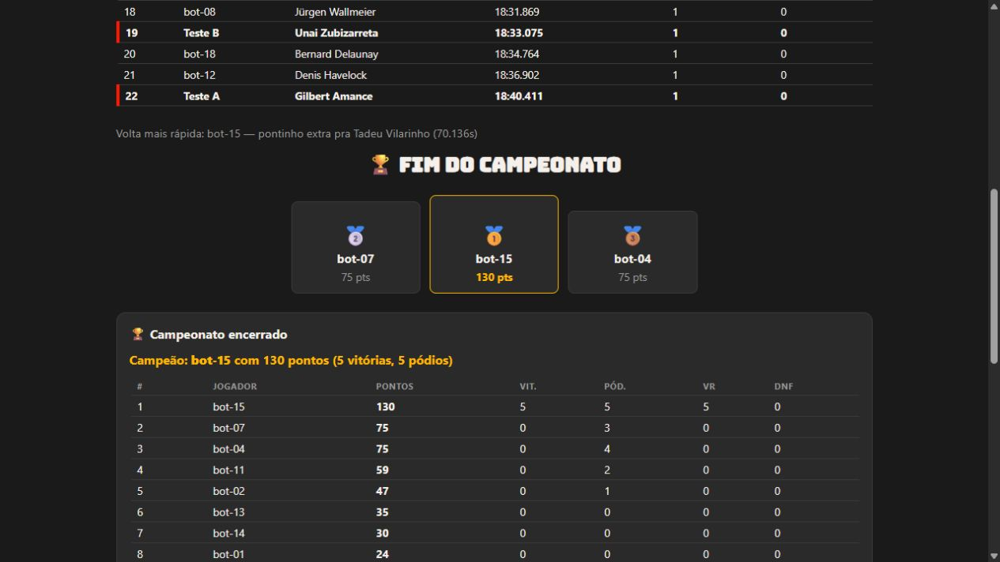

# Testar o build integrado no computador

Requer Node 24 e dependências já instaladas (`npm ci` em um clone novo).

```powershell
npm run start:local
```

Abra http://127.0.0.1:8787. O comando compila o frontend, verifica o bundle do
Worker e serve ambos pelo Wrangler local. Não faz deploy nem exige login na
Cloudflare. A porta ocupada é erro, não uma troca silenciosa de porta.

O servidor escuta somente no computador. Para testar duas pessoas, use duas
sessões de navegador (por exemplo normal e anônima), compartilhando o link da
sala. Abas na mesma sessão compartilham a identidade salva em localStorage.

Neste modo ENVIRONMENT continua production. Só as origens locais explícitas
127.0.0.1:8787 e localhost:8787 são permitidas. A CSP do build fica ativa.
O online cria um campeonato de cinco etapas; corrida única e dez etapas são
formatos locais. F5 deve reconstruir o draft e a etapa atual.

## Conferência antes de publicar

1. Criar sala, entrar nas duas sessões, marcar pronto e concluir o draft.
2. Conferir cinco etapas e classificação iguais, incluindo F5 e reconexão.
3. Conferir sala inexistente, origens recusadas e fechamento da sala.

## Produção publicada

O Worker usa Static Assets e serve dist/ na mesma origem de /criar-sala e
/parties/*. API nunca cai no fallback HTML da SPA. Build deve preceder o Worker
também nos testes: `npm run build` antes de `npm run test:party`.

Endereço: https://f1-fantasy-sala.marcosfeliperigoto.workers.dev

ALLOWED_ORIGINS usa essa origem HTTPS exata, sem barra final, e ENVIRONMENT é
production. O usuário confirmou o teste online com amigos. Conferência adicional:
site HTTP 200, preflight da origem pública liberado e origem externa sem liberação.
Não usar VITE_WS_BASE para outra origem sem revisar a CSP.
O frontend e o Worker são publicados juntos. Salas de versões antigas devem
ser encerradas antes da atualização: a versão atual é 3.4.7, com nomes e ids originais.
Saves locais anteriores ao formato 4 são incompatíveis; comece um campeonato novo.

Push e deploy dependem de autorização explícita. CI não publica automaticamente.

## Validação realizada em 2026-10-16

Build, lint, typecheck, 1724 testes principais e 46 testes Worker passaram.
No navegador, dois jogadores concluíram o draft e viram resultados iguais.
A primeira etapa revelou um bug: o servidor avançava sem incrementar a sequência
do snapshot, e os clientes descartavam a atualização. Corrigido e coberto por
dois testes de cinco etapas (confirmações e timeout), vermelhos antes do conserto.
Após reiniciar o servidor, os clientes retomaram e concluíram as etapas 2–5,
com textos finais idênticos. F5 também foi exercitado.



Ao recompilar com Wrangler aberto, o watcher de dist pode parar no Windows.
Pare o servidor antes de rodar start:local novamente. O CI também passou no GitHub na entrega anterior. Cada PR deve passar novamente
antes do merge; o workflow não publica automaticamente.

Referência: https://developers.cloudflare.com/workers/static-assets/binding/

## Nomes originais (2026-10-17)

Pilotos, equipes, marcas das peças e Montreal (Gilles Villeneuve) restaurados.
Use npm run dataset:publicar para regenerar o dado servido. As assinaturas de
notas e os goldens confirmam a preservação dos valores e da ordem.

## Atualizar a produção

Na versão aprovada, execute `npm run build` e `npx wrangler deploy`. A autenticação
do Wrangler é separada do MCP Cloudflare; se necessário, use
`npx wrangler login --device` e conclua a autorização no navegador.
Não atualize no meio de uma partida quando houver mudança de versão/ids.
